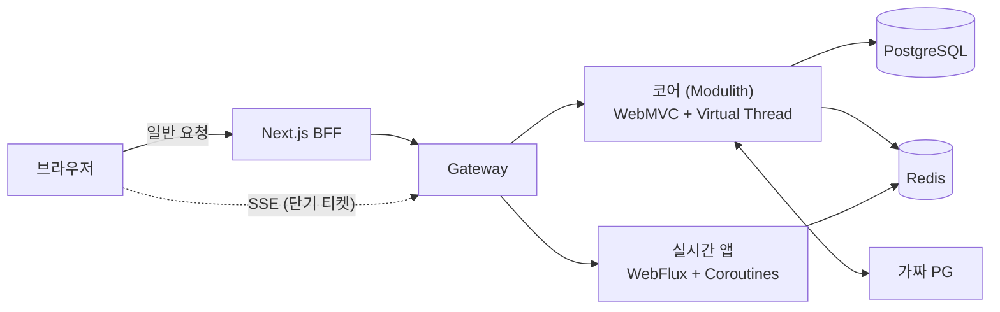

# ticketing

지정석 공연 티켓 예매 서비스. 대기열, 좌석 선점, 결제, 정산을 다루며 Modulith로 시작해 MSA + k8s로 전환하는 과정을 담는 학습·포트폴리오 프로젝트다.

> 현재 상태: 설계 합의 완료, 구현 미착수. 진행 상황은 [로드맵](docs/roadmap.md) 참고.

## 다루는 문제

- **좌석 중복 판매 방지**: Redis 임시 선점(Lua, TTL 5분)과 DB 유니크 제약의 2단계 방어
- **트래픽 줄 세우기**: Redis Sorted Set 대기열, SSE 순번 push, Gateway의 입장 토큰 검증
- **결제 정합성**: 이벤트 기반 결제, 멱등 키, 만료 후 결제 성공 시 자동 환불, 결제 대사 Batch
- **토큰 비노출 BFF**: JWT를 브라우저에 주지 않는 Next.js BFF, 여러 API 조합
- **분리 가능한 구조**: 모듈별 스키마, 이벤트 통신으로 MSA 전환 비용을 미리 낮춤

## 구성



| 단위 | 역할 |
|---|---|
| `core` | 도메인 로직. `member` · `catalog` · `booking` · `payment` · `settlement` · `notification` |
| `core-batch` | 일별 정산, 미결제 예매 정리, 결제 대사 |
| `realtime` | 대기열, 순번·좌석 현황 SSE |
| `gateway` | 라우팅, 입장 토큰·SSE 티켓 검증, rate limit |
| `fake-pg` | 지연·실패·중복 웹훅을 재현하는 가짜 PG |
| `web` | Next.js BFF와 화면 |

## 기술 스택

- **Backend**: Kotlin, Java 25, Spring Boot 4.x, Spring WebMVC + Virtual Thread, Spring WebFlux + Coroutines, Spring Modulith, Spring Security, Spring Batch, Spring Cloud Gateway
- **Data**: PostgreSQL, JPA(쓰기) + jOOQ(조회), Flyway, Redis
- **Frontend**: Next.js (App Router), TypeScript
- **Test**: Testcontainers, k6

## 문서

| 문서 | 내용 |
|---|---|
| [docs/design.md](docs/design.md) | 설계 합의서 |
| [docs/roadmap.md](docs/roadmap.md) | 단계별 구현 로드맵 (M0 ~ M6) |
| [docs/adr/](docs/adr/README.md) | 아키텍처 결정 기록: 검토한 대안과 선택 이유 |
| [CLAUDE.md](CLAUDE.md) | 작업 지침 |

## 실행

M0(프로젝트 뼈대) 완료 후 작성한다.

### M0 로컬 실행

`.env.example`을 `.env`로 복사해 PostgreSQL 비밀번호를 설정한 뒤 다음 명령을 실행한다. Compose는 `.env`를 자동으로 읽지만 Gradle과 애플리케이션은 셸 환경 변수로 전달해야 한다.

```bash
cp .env.example .env
set -a; source .env; set +a
docker compose up -d
./gradlew :core:jooqCodegen
./gradlew build
./gradlew :core:bootRun
```

`jooqCodegen`은 Flyway 마이그레이션을 먼저 적용하고 로컬 PostgreSQL에서 코드를 생성한다. 접속 주소와 사용자를 바꾸려면 `TICKETING_DB_URL`, `TICKETING_DB_USER`를 설정한다. 생성 코드는 `core/build`에 저장한다.
