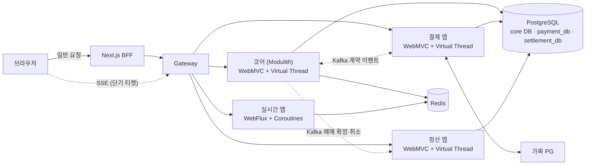

# ticketing

지정석 공연 티켓 예매 서비스. 대기열, 좌석 선점, 결제, 정산을 다루며 Modulith로 시작해 MSA + k8s로 전환하는 과정을 담는 학습·포트폴리오 프로젝트다.

> M0–M5를 완료했고 M6를 진행 중이다. B 예매 p95 300ms 잠정 기준은 미달로 남아 있다. [로드맵](docs/roadmap.md)

## 다루는 문제

- **좌석 중복 판매 방지**: Redis 임시 선점(Lua, TTL 5분)과 DB 유니크 제약의 2단계 방어
- **트래픽 줄 세우기**: Redis Sorted Set 대기열, SSE 순번 push, Gateway의 입장 토큰 검증
- **결제 정합성**: 이벤트 기반 결제, 멱등 키, 만료 후 결제 성공 시 자동 환불, 결제 대사 Batch
- **토큰 비노출 BFF**: JWT를 브라우저에 주지 않는 Next.js BFF, 여러 API 조합
- **분리 가능한 구조**: 모듈별 스키마, 이벤트 통신으로 MSA 전환 비용을 미리 낮춤

## 구성



| 단위 | 역할 |
|---|---|
| `core` | 회원·공연·예매·쿠폰·알림·감사와 결제 계약 이벤트 |
| `core-batch` | 미결제 예매 정리, 좌석 스냅샷 보정, 쿠폰 예약 정리 |
| `payment` | 결제 요청·환불·웹훅·조회. 전용 DB `payment_db`, 포트 18085. 웹훅은 fake-pg가 직접 호출 |
| `payment-batch` | 결제 대사 Job. core와 별도로 `payment_db`를 쓴다 |
| `settlement` | 예매 확정·취소 사본 적재와 주최자 정산 조회. 전용 DB `settlement_db`, 포트 18086 |
| `settlement-batch` | `settlement_db`에서 실행하는 일별 정산 Job |
| `realtime` | 대기열, 순번·좌석 현황 SSE |
| `gateway` | 라우팅, 입장 토큰·SSE 티켓 검증, rate limit |
| `fake-pg` | 지연·실패·중복 웹훅을 재현하는 가짜 PG |
| `web` | Next.js BFF와 화면 |

## 기술 스택

- **Backend**: Kotlin, Java 25, Spring Boot 4.x, Spring WebMVC + Virtual Thread, Spring WebFlux + Coroutines, Spring Modulith, Spring Security, Spring Batch, Spring Cloud Gateway
- **Data**: PostgreSQL, JPA(쓰기) + jOOQ(조회), Flyway, Redis
- **Frontend**: Next.js (App Router), TypeScript
- **Test**: Testcontainers, k6

## 문서

| 문서 | 내용 |
|---|---|
| [docs/architecture.md](docs/architecture.md) | 아키텍처 문서 |
| [docs/roadmap.md](docs/roadmap.md) | 단계별 구현 로드맵 (M0 ~ M6) |
| [docs/adr/](docs/adr/README.md) | 아키텍처 결정 기록: 검토한 대안과 선택 이유 |
| [docs/onboarding.md](docs/onboarding.md) | 온보딩: 로컬 실행, 저장소 지도, 검증 방법 |
| [docs/runbook.md](docs/runbook.md) | 런북: 기동·종료, 장애 진단, Batch 실행 |
| [CLAUDE.md](CLAUDE.md) | 작업 지침 |

## 실행

전체 절차는 [온보딩](docs/onboarding.md)을 따른다.

개발 스택은 `./scripts/dev/run.sh`로 기동한다. `--infra`, `--core`, `--payment`, `--settlement`, `--realtime`, `--gateway`, `--web`, `--observability`를 조합해 선택할 수 있으며, 자세한 사용법은 `--help`를 참고한다. 앱은 Ctrl+C로 종료하고 Docker 컨테이너는 유지한다.

개발 Java 앱은 Scouter를 연결한다. `.env` 또는 환경 변수의 `SCOUTER_AGENT_DIR`에 에이전트 디렉터리 절대 경로를 지정한다. 개발·부하 테스트 모두 코어는 `deploy/scouter/ticketing.conf`, Gateway는 `deploy/scouter/ticketing-gateway.conf`, realtime은 `deploy/scouter/ticketing-realtime.conf`를 사용한다. Gateway·realtime은 SSE 계측 비용을 줄이기 위해 Reactor 훅을 끄므로 WebFlux HTTP XLog·요청 TPS·응답시간을 수집하지 않는다. HTTP 관측은 Micrometer 지표·추적을 사용한다.

fake-pg는 컨테이너가 아니라 `./scripts/dev/run.sh --fake-pg`(또는 e2e·부하 테스트 스크립트)가 호스트에서 jar로 기동한다. Compose는 PostgreSQL·Redis·Kafka만 올린다.

```bash
cp .env.example .env                 # 최초 1회. payment와 fake-pg는 같은 FAKE_PG_WEBHOOK_SECRET을 쓴다
docker compose up -d                 # PostgreSQL, Redis, Kafka
```

시드 데이터(공연장 2곳, 공연 3편, 회차 각 3개)는 `SPRING_PROFILES_ACTIVE=seed ./gradlew :core:bootRun`으로 넣는다. 주최자 ID는 `ticketing.seed.organizer-id`(기본 1)이고, 다시 실행해도 늘지 않는다.
