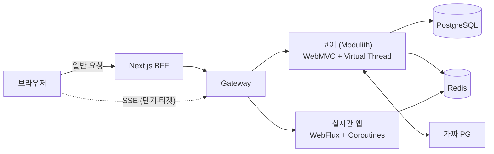

# ticketing

지정석 공연 티켓 예매 서비스. 대기열, 좌석 선점, 결제, 정산을 다루며 Modulith로 시작해 MSA + k8s로 전환하는 과정을 담는 학습·포트폴리오 프로젝트다.

> 현재 상태: M0–M4 구현 완료, M5(부하 테스트와 관측)부터 진행 예정. 자세한 진행 상황은 [로드맵](docs/roadmap.md) 참고.

## 다루는 문제

- **좌석 중복 판매 방지**: Redis 임시 선점(Lua, TTL 5분)과 DB 유니크 제약의 2단계 방어
- **트래픽 줄 세우기**: Redis Sorted Set 대기열, SSE 순번 push, Gateway의 입장 토큰 검증
- **결제 정합성**: 이벤트 기반 결제, 멱등 키, 만료 후 결제 성공 시 자동 환불, 결제 대사 Batch
- **토큰 비노출 BFF**: JWT를 브라우저에 주지 않는 Next.js BFF, 여러 API 조합
- **분리 가능한 구조**: 모듈별 스키마, 이벤트 통신으로 MSA 전환 비용을 미리 낮춤

## 구성



| 단위 | 역할 |
|---|---|
| `core` | 도메인 로직. `member` · `catalog` · `booking` · `payment` · `settlement` · `notification` |
| `core-batch` | 일별 정산, 미결제 예매 정리, 결제 대사 |
| `realtime` | 대기열, 순번·좌석 현황 SSE |
| `gateway` | 라우팅, 입장 토큰·SSE 티켓 검증, rate limit |
| `fake-pg` | 지연·실패·중복 웹훅을 재현하는 가짜 PG |
| `web` | Next.js BFF와 화면 |

## 기술 스택

- **Backend**: Kotlin, Java 25, Spring Boot 4.x, Spring WebMVC + Virtual Thread, Spring WebFlux + Coroutines, Spring Modulith, Spring Security, Spring Batch, Spring Cloud Gateway
- **Data**: PostgreSQL, JPA(쓰기) + jOOQ(조회), Flyway, Redis
- **Frontend**: Next.js (App Router), TypeScript
- **Test**: Testcontainers, k6

## 문서

| 문서 | 내용 |
|---|---|
| [docs/architecture.md](docs/architecture.md) | 아키텍처 문서 |
| [docs/roadmap.md](docs/roadmap.md) | 단계별 구현 로드맵 (M0 ~ M6) |
| [docs/adr/](docs/adr/README.md) | 아키텍처 결정 기록: 검토한 대안과 선택 이유 |
| [docs/onboarding.md](docs/onboarding.md) | 온보딩: 로컬 실행, 저장소 지도, 검증 방법 |
| [docs/runbook.md](docs/runbook.md) | 런북: 기동·종료, 장애 진단, Batch 실행 |
| [CLAUDE.md](CLAUDE.md) | 작업 지침 |

## 실행

전체 절차는 [온보딩](docs/onboarding.md)을 따른다.

fake-pg 컨테이너는 빌드된 jar를 복사하므로 먼저 bootJar를 만든 뒤 Compose를 올린다.

```bash
cp .env.example .env                 # 최초 1회. FAKE_PG_WEBHOOK_SECRET은 코어와 같은 값으로 맞춘다
./gradlew :fake-pg:bootJar
docker compose up -d                 # PostgreSQL, Redis, fake-pg
```

시드 데이터(공연장 2곳, 공연 3편, 회차 각 3개)는 `SPRING_PROFILES_ACTIVE=seed ./gradlew :core:bootRun`으로 넣는다. 주최자 ID는 `ticketing.seed.organizer-id`(기본 1)이고, 다시 실행해도 늘지 않는다.
