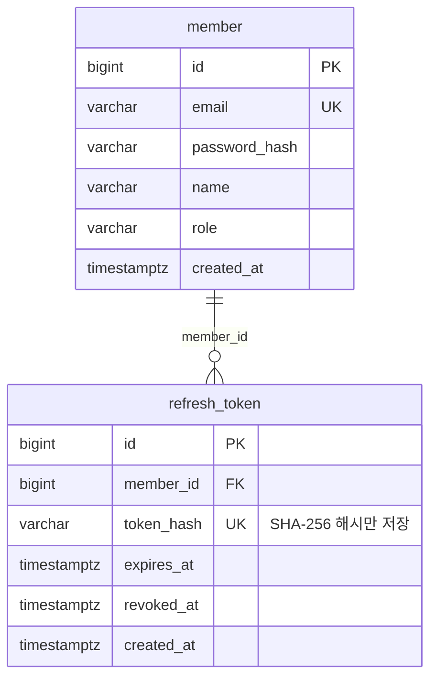
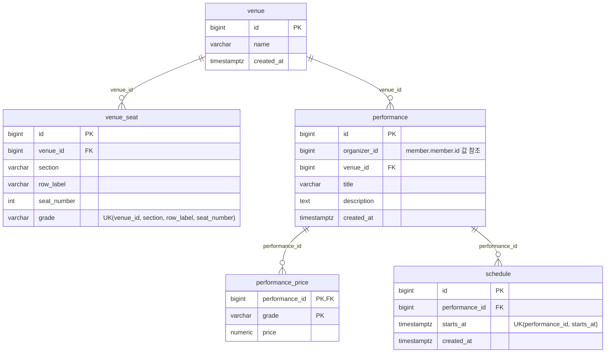
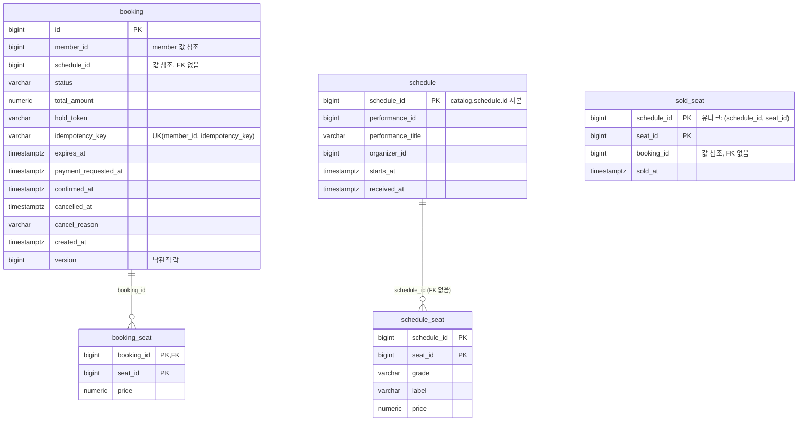
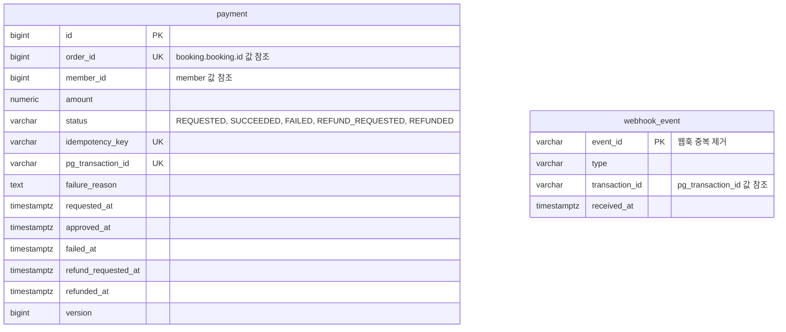
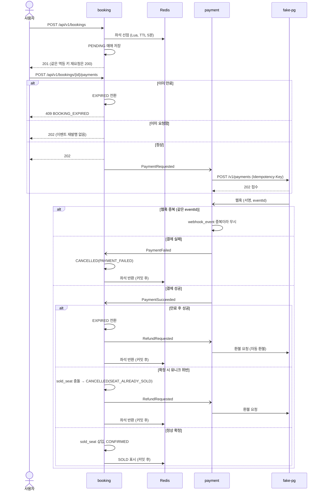

# 아키텍처

구현 순서와 진행 상태는 [roadmap.md](./roadmap.md), 결정별 대안과 선택 이유는 [adr/](./adr/README.md)를 본다.

## 1. 프로젝트 개요

| 항목 | 내용 |
|---|---|
| 목적 | 학습 겸 포트폴리오. 스택의 각 요소가 실제 필요에 의해 쓰이는 것이 기준 |
| 인원·기한 | 1인, 기한 없음 |
| 도메인 | 공연/티켓 예매 (지정석) |
| 저장소 | 모노레포 `ticketing` |
| 기본 패키지 | `io.github.ticketing` |
| 장기 계획 | Modulith → MSA + k8s |

도메인 선정 이유: 대기열, 좌석 선점, 결제, 정산이 모듈 경계로 나뉘고, 트랜잭션 중심 코어(MVC)와 실시간 팬아웃(WebFlux+SSE)이 자연스럽게 분리된다.

## 2. 기술 스택

| 영역 | 선택 |
|---|---|
| 언어 | 전부 Kotlin (JPA용 `allopen`, `noarg` 플러그인 사용) |
| 런타임 | Java 25 (LTS) |
| 프레임워크 | Spring Boot 4.x 최신 안정판 |
| 빌드 | Gradle Kotlin DSL, 멀티 모듈 |
| 코어 웹 | Spring WebMVC + Virtual Thread |
| 실시간 웹 | Spring WebFlux + Coroutines + SSE |
| Gateway | Spring Cloud Gateway (WebFlux) |
| 모듈화 | Spring Modulith |
| 영속성 | JPA(쓰기) + jOOQ(조회·집계), Flyway |
| DB | PostgreSQL |
| 캐시·메시징 | Redis (캐시, 좌석 선점, 대기열, Streams) |
| 배치 | Spring Batch |
| 보안 | Spring Security, JWT |
| 프런트 | Next.js 최신 안정판 (App Router) + TypeScript, BFF 역할 |

### 확정 버전

| 항목 | 버전 | 비고 |
|---|---|---|
| Java | 25 (Temurin) | toolchain으로 고정 |
| Kotlin | 2.3.21 | |
| Spring Boot | 4.1.2 | |
| Spring Modulith | 2.1.1 | BOM으로 관리 |
| Spring Cloud | 2025.1.4 | Gateway는 `spring-cloud-starter-gateway-server-webflux` |
| jOOQ | 3.21.9 | Boot BOM 관리. 코드 생성은 Testcontainers + Flyway 기반 |
| Gradle | 9.8.2 | wrapper |
| PostgreSQL / Redis | 18.3-alpine / 8.6.2-alpine | Compose, Testcontainers 공통 |

버전은 `gradle/libs.versions.toml`이 기준이다. Boot BOM이 관리하는 라이브러리(jOOQ, Flyway, Testcontainers)는 BOM을 따른다.

### 빌드 구조 메모

- 공통 빌드 설정은 `build-logic/`의 convention plugin(`ticketing.kotlin-conventions`, `ticketing.spring-conventions`, `ticketing.jpa-conventions`)에 둔다.
- jOOQ 생성 코드의 패키지는 `ticketing.jooq`다. Modulith는 `io.github.ticketing`의 직계 하위 패키지를 모두 모듈로 보므로 루트 밖에 둔다.
- Modulith 모듈 선언은 Kotlin에 `package-info`가 없어 `core/src/main/java/.../<모듈>/package-info.java`에 둔다 (Java 파일은 이것뿐).
- Modulith 이벤트 발행 레지스트리 테이블(`event_publication`)은 `public` 스키마에 둔다.

## 3. 시스템 구성

```
브라우저
  ├─ 일반 요청 ──▶ Next.js BFF ──▶ Gateway ──▶ 코어 (Modulith, MVC+VT)
  └─ SSE(단기 티켓) ───────────▶ Gateway ──▶ 실시간 앱 (WebFlux+Coroutines)

코어 ──▶ PostgreSQL (모듈별 스키마)
코어 ──▶ Redis (좌석 선점, 좌석 스냅샷, Streams 발행)
실시간 앱 ──▶ Redis (대기열, Streams 구독)   ※ PostgreSQL 접근 없음
코어 ──▶ 가짜 PG 서버 (결제 요청) / 가짜 PG ──▶ 코어 (웹훅)
```

### 배포 단위

| 단위 | 루트 패키지 | 역할 |
|---|---|---|
| `core` | `io.github.ticketing` | 도메인 로직 전체. Modulith |
| `core-batch` | `io.github.ticketing` (core 코드 공유) | Spring Batch 실행 모듈. 추후 k8s CronJob |
| `realtime` | `io.github.ticketing.realtime` | 대기열, SSE push. 상태 없음(Redis만 사용) |
| `gateway` | `io.github.ticketing.gateway` | 라우팅, 입장 토큰 검증, SSE 티켓 검증, rate limit |
| `fake-pg` | `io.github.ticketing.fakepg` | 지연·실패·중복 웹훅을 재현하는 가짜 PG |
| `web` | - | Next.js BFF + 화면 |

한 JVM 앱에는 웹 스택이 하나만 올라가므로 MVC와 WebFlux는 배포 단위로 분리한다.

## 4. 코어 모듈 (Modulith)

Spring Modulith는 메인 클래스 패키지의 직계 하위 패키지를 모듈로 인식한다. 따라서 `io.github.ticketing.<모듈명>` 구조가 곧 모듈 경계다.

| 모듈 | 책임 | 구조 |
|---|---|---|
| `member` | 회원 가입, 로그인, JWT 발급, 역할 | 계층형 |
| `catalog` | 공연, 회차, 공연장, 좌석 배치 | 계층형 |
| `booking` | 좌석 선점, 예매 생성·확정·만료·취소 | 헥사고날 |
| `payment` | 결제 요청, 웹훅 처리, 환불, 결제 대사 (Batch) | 헥사고날 |
| `settlement` | 정산 (Batch). M2에서 구현 | 헥사고날 |
| `notification` | 알림 (초기에는 로그 출력). M1-6에서 구현 | 계층형 |

대기열(`queue`)은 코어가 아니라 `realtime` 앱 소유다. 코어는 대기열의 존재를 모른다.

### 모듈 규칙

- 모듈 간 호출은 **Modulith 이벤트**(`ApplicationModuleListener` + 이벤트 발행 레지스트리)로 한다.
- 다른 모듈의 데이터는 ID 참조와 이벤트로만 접근한다.
- 경계와 의존 방향은 Modulith 검증 테스트(`ApplicationModules.verify()`)와 ArchUnit으로 강제한다.
- MSA 분리 1순위는 `payment`, `settlement`.
- **결제 계약 이벤트의 소유**: `PaymentRequested`, `RefundRequested`, `PaymentSucceeded`, `PaymentFailed`, `PaymentRefunded`는 모두 `payment` 모듈 루트에 둔다. 의존 방향은 `booking → payment` 하나다. `payment`는 예매를 모르고 `orderId`만 안다. 양쪽이 각자 이벤트를 소유하면 순환이 생겨 `ApplicationModules.verify()`가 실패한다. [ADR 0017](./adr/0017-payment-owns-payment-events.md) 참고.

### 헥사고날 모듈의 패키지 구조

Kotlin 키워드와 겹치지 않도록 입력 측 패키지는 `provided`, 출력 측 패키지는 `required`로 명명한다. [ADR 0016](./adr/0016-provided-required-packages.md) 참고.

```
io.github.ticketing.booking
├── domain            순수 도메인 모델, 프레임워크 의존 없음
├── application
│   ├── port.provided 유스케이스 인터페이스
│   ├── port.required CommandPort(쓰기) / QueryPort(조회) 분리
│   └── service       유스케이스 구현
└── adapter
    ├── provided.web  컨트롤러
    ├── provided.event 이벤트 리스너
    └── required
        ├── jpa       CommandPort 구현
        ├── jooq      QueryPort 구현
        └── redis     좌석 선점 등
```

### 모듈 의존 다이어그램

Modulith `Documenter`가 생성한다(`DocumentationTests`, 출력 `docs/modulith/`). 모듈 의존을 바꾸면 테스트를 다시 실행해 바뀐 `.puml`을 함께 커밋한다.

- [전체 모듈 의존](./modulith/components.puml)
- 모듈별: [booking](./modulith/module-booking.puml), [catalog](./modulith/module-catalog.puml), [payment](./modulith/module-payment.puml), [member](./modulith/module-member.puml), [settlement](./modulith/module-settlement.puml), [notification](./modulith/module-notification.puml)

의존 방향은 `booking → catalog`(회차 사본 수신), `booking → payment`(결제 계약 이벤트), `notification → booking`(예매 알림 이벤트), `settlement → booking`(정산 사본 이벤트)이다.

### 이벤트 목록

이벤트 클래스는 발행 모듈의 루트 패키지에 둔다. 금액은 `BigDecimal`(원 단위), 시각은 `Instant`다.

| 이벤트 | 발행 모듈 | 구독 모듈 | 페이로드 |
|---|---|---|---|
| `ScheduleRegistered` | catalog | booking | `scheduleId`, `performanceId`, `performanceTitle`, `organizerId`, `startsAt`, `seats`(`seatId`, `grade`, `label`, `price`) |
| `PaymentRequested` | booking | payment | `orderId`(=예매 ID), `memberId`, `amount`, `idempotencyKey`, `requestedAt` |
| `RefundRequested` | booking | payment | `orderId`, `reason`, `requestedAt` |
| `PaymentSucceeded` | payment | booking | `paymentId`, `orderId`, `amount`, `paidAt` |
| `PaymentFailed` | payment | booking | `paymentId`, `orderId`, `reason`, `failedAt` |
| `PaymentRefunded` | payment | booking | `paymentId`, `orderId`, `refundedAt` |
| `BookingConfirmed` | booking | notification, settlement | `bookingId`, `memberId`, `scheduleId`, `performanceId`, `organizerId`, `seatIds`, `amount`, `confirmedAt` |
| `BookingCancelled` | booking | notification, settlement | `bookingId`, `memberId`, `scheduleId`, `performanceId`, `organizerId`, `reason`, `refundRequired`, `cancelledAt` |
| `BookingExpired` | booking | 없음(notification) | `bookingId`, `memberId`, `scheduleId`, `expiredAt` |

- 결제 계약 이벤트 5종(`PaymentRequested`, `RefundRequested`, `PaymentSucceeded`, `PaymentFailed`, `PaymentRefunded`)은 `payment` 모듈이 소유한다. 발행자는 위 표와 같지만 클래스는 `payment` 루트 패키지에 있다.
- 구독자는 `adapter.provided.event`의 `@ApplicationModuleListener`다. booking은 `ScheduleRegisteredListener`, `PaymentResultListener`, payment는 `PaymentRequestListener`, `RefundRequestListener`다. `PaymentRefunded`는 booking이 로그만 남긴다. notification은 `BookingNotificationListener`로 확정·취소를 로그에 남긴다. 로그는 재전달 시 중복될 수 있으며 실제 알림 발송 시 영속적인 중복 방지가 필요하다.

## 5. 데이터

### PostgreSQL

- 인스턴스 하나, **모듈별 스키마 분리**: `member`, `catalog`, `booking`, `payment`, `settlement`
- **모듈 간 외래 키·조인 금지**
- `settlement`의 집계에 필요한 타 모듈 데이터는 이벤트로 받아 자기 스키마에 사본으로 쌓는다.
- 스키마 관리는 Flyway, jOOQ 코드는 Flyway가 만든 스키마에서 생성한다.

### booking 스키마 데이터

- **좌석 사본**: `booking`은 `catalog`의 `ScheduleRegistered`를 받아 `booking.schedule`과 `booking.schedule_seat`에 회차와 좌석·가격 사본을 둔다. `catalog`를 직접 조회하지 않는다.
- **`booking.sold_seat (schedule_id, seat_id)`**: 확정 시에만 행을 넣고 취소 시 지우는 테이블이며 여기에 유니크 제약을 둔다. 예매 좌석 테이블에 유니크를 걸면 취소·만료된 예매가 좌석을 계속 점유하기 때문이다.

### 테이블 구조 (ERD)

스키마별로 그린다. 스키마를 넘는 관계는 FK가 없고 값으로만 참조하므로 선을 긋지 않고 주석으로 표시한다. 원본은 `core/src/main/resources/db/migration/V*.sql`이다. 이 외에 `public.event_publication`(Modulith 이벤트 발행 레지스트리)이 있다.

#### member



#### catalog



#### booking

`schedule`, `schedule_seat`는 `ScheduleRegistered`로 받은 catalog 사본이다.



#### payment



### JPA와 jOOQ 역할 분담

- 명령(쓰기): JPA. JPA로 표현할 수 없는 쓰기(`ON CONFLICT` upsert, 엔티티 없는 테이블)는 jOOQ DSL. 문자열 SQL은 쓰지 않는다
- 조회(목록, 통계, 정산 집계): jOOQ
- 출력 포트를 `CommandPort` / `QueryPort`로 나누고 어댑터를 각각 구현한다.

### Redis 용도

| 용도 | 자료구조 | 소유 |
|---|---|---|
| 좌석 임시 선점 | `SET NX` + TTL, 다중 좌석은 Lua | 코어 `booking` |
| 좌석 현황 스냅샷 | Hash 등 (회차별) | 코어가 유지, 실시간 앱이 읽음 |
| 좌석 상태 변경 전달 | Streams | 코어 발행, 실시간 앱 구독 |
| 대기열 | Sorted Set | 실시간 앱 |
| 입장 토큰 | 단기 키 | 실시간 앱 발급, Gateway 검증 |
| 조회 캐시 | 공연·회차 정보 | 코어 `catalog` |

`catalog` 캐시는 트랜잭션 안의 변경을 커밋 뒤 적용하고, Redis 쓰기·삭제 완료를 기다린다(`RedisCacheWriter.immediateWrites`).

#### 좌석 선점 키 형식 (코어 `booking`, realtime이 읽음)

모든 키에 `{scheduleId}` 해시 태그를 넣어 Lua가 다루는 키를 같은 슬롯에 둔다.

| 키 | 자료구조 | 내용 |
|---|---|---|
| `booking:hold:{<scheduleId>}:<seatId>` | String, PX TTL | 값은 선점 소유자(`HoldToken`) |
| `booking:seats:{<scheduleId>}` | Hash | field `seatId` → `AVAILABLE` / `HELD:<만료 epoch ms>` / `SOLD` |
| `booking:seat-events:{<scheduleId>}` | Stream, `MAXLEN ~ 10000` | `seatIds`(쉼표 구분), `status`, `holdExpiresAt`(HELD일 때), `at`(epoch ms) |

- 스냅샷의 `HELD:<만료 시각>`: 선점 키 TTL이 끝나도 Redis는 알려 주지 않으므로 읽는 쪽이 만료를 직접 판정한다.
- 선점 가능 여부의 판단 기준은 스냅샷이 아니라 선점 키와 `SOLD`다.
- 선점·해제·판매·판매 해제는 각각 Lua 스크립트 한 번으로 처리하며, 같은 스크립트에서 스냅샷과 Stream을 갱신한다.
- DB 커밋 뒤 Redis 반영이 실패하면 경고 로그만 남긴다. 선점 키는 TTL로 정리되고 스냅샷 보정은 M2 Batch가 한다(6.4절).

## 6. 핵심 흐름

### 6.1 대기열과 입장

1. 사용자가 예매 페이지 진입 시 실시간 앱의 대기열(Sorted Set)에 등록된다.
2. 실시간 앱이 순번을 SSE로 push한다.
3. 차례가 되면 **짧은 수명의 입장 토큰**을 발급한다.
4. Gateway가 예매 API 요청에서 입장 토큰을 검증한다. 코어는 관여하지 않는다.

### 6.2 좌석 선점

- 1회 예매 최대 **4매**
- 선점 유지 시간(TTL) **5분**
- 여러 좌석은 Lua 스크립트로 **전부 성공하거나 전부 실패**
- 최종 확정은 결제 성공 시 DB 기록. `booking.sold_seat`의 `(회차, 좌석)` **유니크 제약**이 마지막 방어선
- API 흐름: `POST /api/v1/bookings`가 Redis 선점과 `PENDING` 생성을 하고, `POST /api/v1/bookings/{id}/payments`가 결제 요청 이벤트를 발행한다.
- 선점·해제·확정 시 좌석 상태 변경을 Redis Streams로 발행하고 스냅샷을 갱신한다.

### 6.2.1 예매 흐름 시퀀스 (대기열 제외)



- 금액 불일치(`AMOUNT_MISMATCH`)도 환불 경로이며 위 유니크 위반과 같은 모양이다.
- `PaymentRequested`, `PaymentSucceeded` 같은 화살표(`-)`)는 Modulith 이벤트(비동기)다.

### 6.3 예매 상태 전이

```
PENDING ──결제 성공──▶ CONFIRMED ──사용자 취소(환불 요청)──▶ CANCELLED(USER_REQUESTED)
   │
   ├──시간 초과──▶ EXPIRED
   ├──사용자 취소──▶ CANCELLED(USER_REQUESTED)
   ├──결제 실패──▶ CANCELLED(PAYMENT_FAILED)
   ├──결제 금액 불일치──▶ CANCELLED(AMOUNT_MISMATCH) + 환불 요청
   └──확정 시 이미 판매된 좌석──▶ CANCELLED(SEAT_ALREADY_SOLD) + 환불 요청
```

- **만료는 지연 판정**: 예매는 `expiresAt = 생성 시각 + 5분`을 갖는다. 결제 요청이나 결제 결과가 도착했을 때 `Clock`과 비교해 `EXPIRED`로 전환한다. 일괄 정리는 M2 Batch가 한다.
- **결제 실패**: `PENDING → CANCELLED`(사유 `PAYMENT_FAILED`)로 바꾸고 좌석을 반환한다. 재결제는 없다.
- **확정 예매 취소**: 즉시 `CANCELLED`(`USER_REQUESTED`)로 바꾸고 `RefundRequested`를 발행한다. 환불은 비동기다.
- **결제 금액 불일치**: 결제는 성공했지만 금액(`compareTo`)이 `totalPrice`와 다르면 확정하지 않는다. `PENDING → CANCELLED`(`AMOUNT_MISMATCH`)로 바꾸고 `RefundRequested`(사유 `AMOUNT_MISMATCH`)와 `BookingCancelled`(`refundRequired=true`)를 발행하며 커밋 후 선점을 해제한다. `sold_seat`는 넣지 않는다. 만료 판정이 먼저라서 만료됐으면 불일치여도 `EXPIRED` 환불 경로다.
- **결제 재요청**(`POST /api/v1/bookings/{id}/payments`): `PENDING`이면 이미 요청했어도 `202`(이벤트는 다시 발행하지 않는다). 이미 요청했다면 만료 시각이 지나도 결제가 진행 중이므로 `202`다. `CONFIRMED`, `CANCELLED`는 `409 INVALID_BOOKING_STATE`, `EXPIRED`는 `409 BOOKING_EXPIRED`.
- **동시 수정 충돌**: HTTP 요청 경로에서 `Booking`의 낙관적 락(`@Version`) 충돌이 나면 `ApiExceptionHandler`가 `409 CONCURRENT_MODIFICATION`으로 변환하며 클라이언트가 다시 시도한다. 이벤트 리스너 경로는 예외를 그대로 던져 이벤트 발행 레지스트리가 재시도한다.
- 같은 결제 결과 이벤트가 다시 와도 상태는 다시 바뀌지 않는다(멱등).

### 6.4 결제 (이벤트 기반)

1. `booking`이 결제 요청 이벤트 발행
2. `payment`가 가짜 PG에 결제 요청 (멱등 키 포함)
3. 가짜 PG가 웹훅으로 결과 통지 (지연, 실패, 중복 가능)
4. `payment`가 멱등 키로 중복을 걸러내고 결과 이벤트 발행
5. `booking`이 `CONFIRMED` 또는 실패 처리(`CANCELLED`, 사유 `PAYMENT_FAILED`, 좌석 반환)

**자동 환불 조건**: 결제는 성공했는데 (a) 예매가 이미 만료됐거나(`EXPIRED`로 전환), (b) 확정 시 `booking.sold_seat` 유니크 제약에 걸려 좌석이 이미 판매된 경우(`CANCELLED`, 사유 `SEAT_ALREADY_SOLD`), `booking`이 `RefundRequested`를 발행해 자동 환불한다.

**결제 결과 처리의 트랜잭션 구조**
- 결과 이벤트는 `@ApplicationModuleListener`(비동기 + 새 트랜잭션)로 받고, DB 작업은 그 리스너 트랜잭션 하나에 참여한다. 내부에서 `REQUIRES_NEW`를 또 열지 않는다. 리스너가 가상 스레드로 상한 없이 동시에 돌아 커넥션을 두 개씩 잡으면 풀 고갈과 교착이 생기기 때문이다.
- 확정 순서는 확정 가능 여부 판정 → `sold_seat` 삽입(`ON CONFLICT DO NOTHING`) → 전부 들어가면 `CONFIRMED`, 일부라도 충돌하면 같은 트랜잭션에서 이 예매의 `sold_seat`를 지우고 `SEAT_ALREADY_SOLD`로 취소한다. 충돌해도 트랜잭션이 깨지지 않아 롤백 후 재시도가 필요 없다.
- Redis 반영(SOLD 표시, 선점 해제)은 트랜잭션 `afterCommit`에서 한다. 롤백되면 Redis를 건드리지 않는다.
- **커밋 후 Redis 반영이 실패하면** 경고 로그만 남긴다. 선점 키는 TTL로 정리되고 스냅샷 보정은 M2 Batch가 한다. 중복 판매는 DB 유니크 제약이 막는다.
- 낙관적 락 충돌은 삼키지 않고 던져 이벤트 발행 레지스트리가 다시 시도하게 한다.

이 구조는 MSA 전환 시 Saga로 그대로 이어진다.

**payment 구현 세부**

- PG를 호출하는 결제·환불 리스너는 `@ApplicationModuleListener(propagation = NOT_SUPPORTED)`로 실행한다. 준비 저장 → 트랜잭션 밖 PG 호출 → 최신 행 재조회·결과 반영으로 나눈다. 위의 booking 결제 결과 리스너 트랜잭션 구조와는 역할이 다르다.
- 결제 상태는 `REQUESTED`, `SUCCEEDED`, `FAILED`, `REFUND_REQUESTED`, `REFUNDED`다. 결제의 미확정 결과(타임아웃·연결 실패·5xx)는 REQUESTED를 유지하고 예외를 전파해 원 이벤트를 미완료로 남긴다. 확정적 거절만 PaymentFailed로 처리한다.
- 환불 거절·미확정은 REFUND_REQUESTED를 유지하고 예외를 전파한다. 해당 상태에서도 동일한 `refund-{orderId}` 키로 PG에 다시 요청한다. REFUNDED면 종료한다.
- 재시작·명시적 이벤트 재제출 시 같은 키와 본문으로 재처리한다. 미완료 기록 자체가 즉시 재시도를 뜻하지 않으며, 주기적 스케줄러는 M1-5에 추가하지 않는다. 웹훅과 M2 대사는 별도 복구 경로다.
- 웹훅 중복 기록·결제 상태 저장·결과 이벤트 발행은 한 트랜잭션이다. 오류 시 중복 기록도 롤백한다. 웹훅 선도착과 지연 PG 응답이 최신 상태를 되돌리지 않게 한다. 병렬 재처리의 HTTP 호출 횟수 대신 실제 거래·환불과 커밋된 상태 전이·이벤트의 중복 방지를 보장한다.
- 설계 근거는 [ADR 0018](./adr/0018-payment-retry-boundaries.md), 별도 세션 지시서(`phases/3-payment`)는 완료 후 삭제되어 git 히스토리에만 남아 있다. `PaymentListenerTests`와 `PaymentFlowTests`에서 트랜잭션 경계, 실제 예매 연계와 원 발행 재제출을 검증한다.

## 7. 인증·인가

- `member` 모듈이 JWT(access/refresh)를 직접 발급한다.
- **BFF가 토큰을 보관·갱신**한다. 브라우저에는 httpOnly 쿠키 세션만 내려가고 토큰은 노출되지 않는다.
- 구현 세부 (M1-1):
  - access JWT는 HS256(대칭키, `JWT_SECRET` 환경 변수), 수명 15분, `sub`=회원 ID, `role` 클레임. 비대칭키(JWKS)는 MSA 전환 시 재검토한다.
  - refresh 토큰은 불투명 난수(수명 14일)이고 SHA-256 해시만 `member.refresh_token`에 저장한다. 갱신할 때마다 이전 토큰을 폐기(로테이션)하며, 폐기된 토큰이 재사용되면 그 회원의 모든 refresh 토큰을 폐기한다.
  - 비밀번호는 BCrypt. 가입 시 역할을 직접 고를 수 있다(플랫폼 관리자가 없어 주최자 승인 절차를 두지 않는다).
- 역할: **일반 사용자**(예매), **주최자**(공연·회차 등록, 정산 조회). 역할 기반 인가 적용.
- SSE는 BFF를 거치지 않는다. BFF가 발급한 **단기 SSE 티켓**으로 브라우저가 Gateway에 직접 연결한다. (Node 프로세스가 장기 연결을 붙드는 것을 피하기 위함)

## 8. BFF (Next.js)

- 일반 API 요청은 전부 BFF를 거친다.
- 조합(Aggregation) 화면
  - 공연 상세: 공연 정보 + 회차별 잔여 좌석 + 내 예매 여부
  - 마이페이지: 예매 내역 + 결제 상태
  - 주최자 대시보드: 판매 현황 + 정산
- 주최자 화면은 최소한으로 만들고, 초기 공연 데이터는 시드 스크립트로 넣는다.

## 9. Batch

| 작업 | 내용 |
|---|---|
| 일별 정산 | 공연·주최자별 매출 집계, 수수료 계산. jOOQ reader, chunk 처리 |
| 미결제 예매 정리 | `PENDING`으로 남은 건을 `EXPIRED`로 전환 (Redis TTL 누락분 보정) |
| 좌석 스냅샷 보정 | 커밋 후 Redis 반영 실패로 DB와 어긋난 좌석 스냅샷을 DB 기준으로 보정 |
| 결제 대사 (`payment`) | 가짜 PG 거래 내역과 내부 결제 기록의 불일치 검출 |

Batch Job은 데이터를 소유한 모듈의 `adapter.provided.batch`에 두고 `@Profile("batch")`로 활성화한다. Batch는 웹 컨트롤러와 같은 입력 어댑터다. `core-batch`는 웹 서버 없이 `batch` 프로필로 core 컨텍스트를 띄우며 `spring.batch.job.name`으로 Job 하나를 실행한다. 웹 앱에서는 Job 빈을 만들지 않고 자동 실행도 끈다. 이 결정의 대안과 근거는 [ADR 0019](./adr/0019-batch-jobs-in-owning-modules.md)를 참고한다.

- 실행: `./gradlew :core-batch:bootRun --args='--spring.batch.job.name=dailySettlementJob targetDate=2026-11-10,java.time.LocalDate run.id=1,java.lang.Long'`. 완료된 같은 날짜를 다시 계산할 때는 식별 파라미터 `run.id`를 새 값으로 바꾼다. 실패한 실행은 같은 `targetDate`와 `run.id`로 재시작한다.
- Batch 메타데이터는 Spring Batch 공식 PostgreSQL DDL을 Flyway 마이그레이션으로 `batch` 스키마에 만든다.
- 정산일은 이벤트 시각의 Asia/Seoul 날짜다. 그날 매출은 `BookingConfirmed` 금액 합, 환불은 `refundRequired=true`인 `BookingCancelled` 중 확정 사본이 있는 예매의 금액 합이다. 지난 날짜의 정산은 다시 계산하지 않는다. 수수료는 `(매출 − 환불) × 수수료율`(설정값, 기본 `0.10`)이며 원 미만은 0 방향으로 절사한다. 지급액은 `매출 − 환불 − 수수료`이고 `(정산일, 공연)` 단위로 upsert한다.
- 결제를 요청하지 않은 `PENDING` 예매는 `expiresAt` 경과 시, 결제를 요청한 `PENDING` 예매는 `expiresAt + 유예`(설정값, 기본 30분) 경과 시 `EXPIRED`로 전환한다. 이후 도착한 결제 성공은 기존 자동 환불 경로로 처리한다.
- 좌석 스냅샷 보정은 시작 전 회차를 대상으로 `sold_seat`와 선점 키를 기준으로 스냅샷을 다시 쓴다.
- 결제 대사는 Asia/Seoul 날짜 기준으로 받은 PG 거래와 같은 날 요청된 내부 결제를 `orderId`로 비교하고 불일치를 기록한다. 자동 보정은 하지 않는다.
- 같은 대상 날짜로 재실행해도 결과가 같도록 upsert 또는 날짜 단위 삭제 후 재적재로 쓴다.

## 10. 외부 연동

- 결제: **가짜 PG 서버**를 직접 만든다. 지연, 타임아웃, 실패, 중복 웹훅을 설정으로 재현한다. 출력 포트로 추상화하여 추후 실제 PG 어댑터를 추가할 수 있게 한다.
- 알림: 로그 출력으로 시작.

### fake-pg 연동 계약

- 결제: `POST /v1/payments`, `Idempotency-Key`, 본문 `{orderId: string, amount: 정수 원 단위}`. 환불: `POST /v1/payments/{transactionId}/refund`, `Idempotency-Key`. 유효한 접수 응답은 202다.
- 거래 조회: `GET /v1/transactions?date=YYYY-MM-DD`의 요청 날짜는 Asia/Seoul 기준이다.
- 웹훅: 코어의 `POST /api/v1/payments/webhooks/fake-pg`로 승인·실패·환불 완료를 전송한다. eventId로 중복 제거하고 transactionId와 orderId·금액의 일치를 검증한다. 동일 거래의 같은 결과는 다른 eventId여도 다시 발행하지 않는다.
- 서명: `X-FakePg-Timestamp`(epoch 초), `X-FakePg-Signature`(hex HMAC-SHA256, 입력은 timestamp·점·원문 바이트). 코어와 PG가 환경 변수 `FAKE_PG_WEBHOOK_SECRET`을 공유한다. 원문으로 검증한 뒤 파싱하며 시각 허용 오차 기본값은 5분이다.
- 어댑터 기본 주소는 `http://localhost:8090`, 연결·읽기 타임아웃은 각각 3초다. 유효한 202는 Accepted, 4xx는 Rejected, 타임아웃·연결 실패·5xx·잘못된 접수 응답은 Unknown으로 분류한다. 재처리는 6.4절 정책을 따른다.
- SUCCESS·FAIL·TIMEOUT·DELAYED·DUPLICATE_WEBHOOK 시나리오는 PG 설정으로 제어한다. TIMEOUT은 HTTP 응답만 늦어도 승인이 진행될 수 있다. fake-pg 자체의 메모리 거래 저장소는 재시작하면 초기화된다.

## 11. 개발 환경과 테스트

- 로컬 실행: Docker Compose (PostgreSQL, Redis, 가짜 PG)
- 통합 테스트: Testcontainers
- 모듈 테스트: Modulith 모듈 단위 테스트(`@ApplicationModuleTest`)
- 동시성 테스트: 같은 좌석에 대한 동시 선점·확정
- 부하 테스트: k6, "1만 명 동시 진입" 시나리오. 개선 전후 수치를 기록한다.
- 관측: Actuator로 시작. 부하 테스트 단계에서 Micrometer + Prometheus + Grafana + 분산 추적으로 확장.
