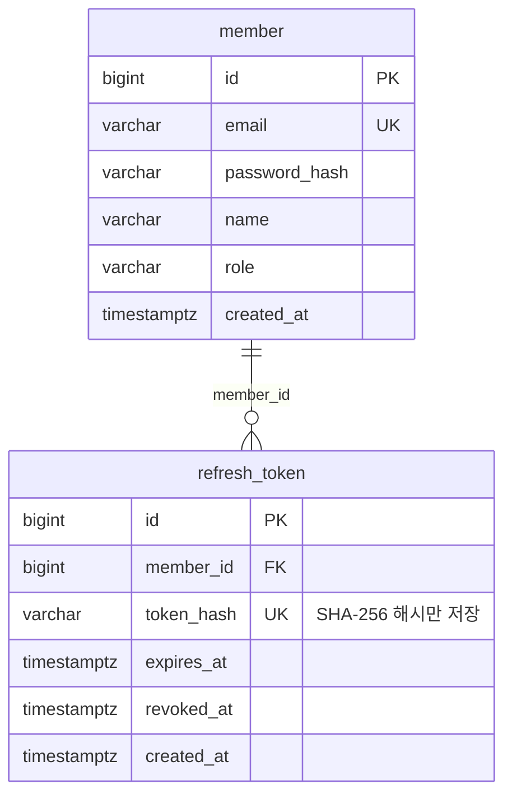
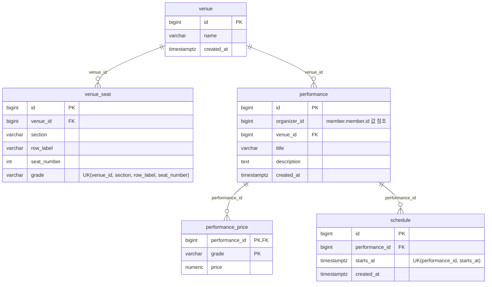
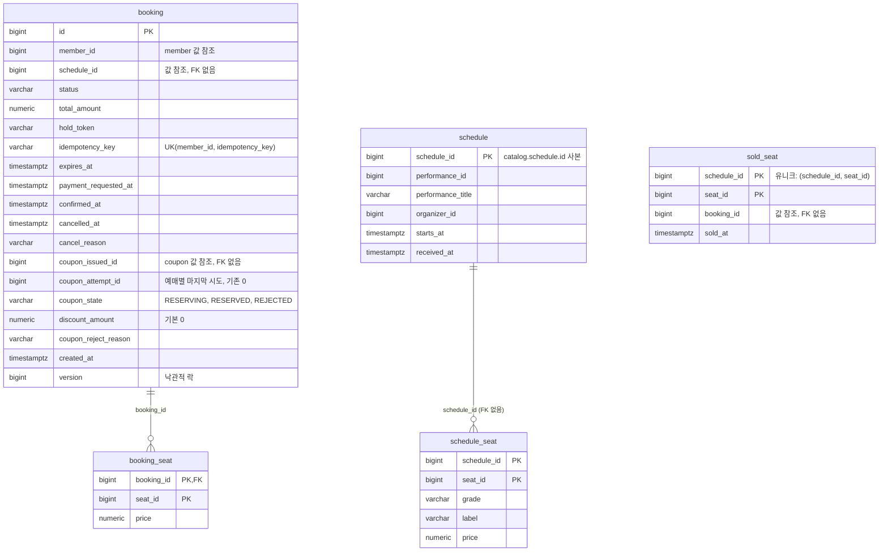
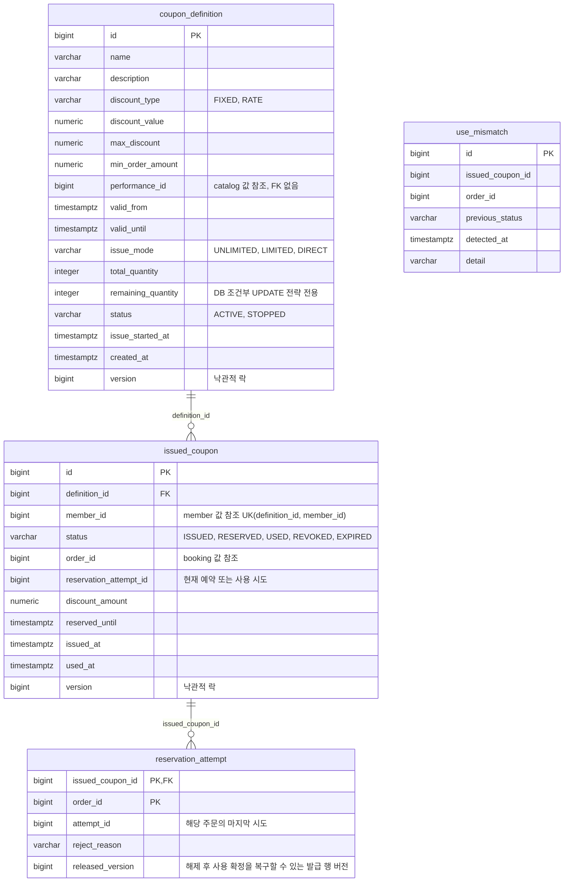
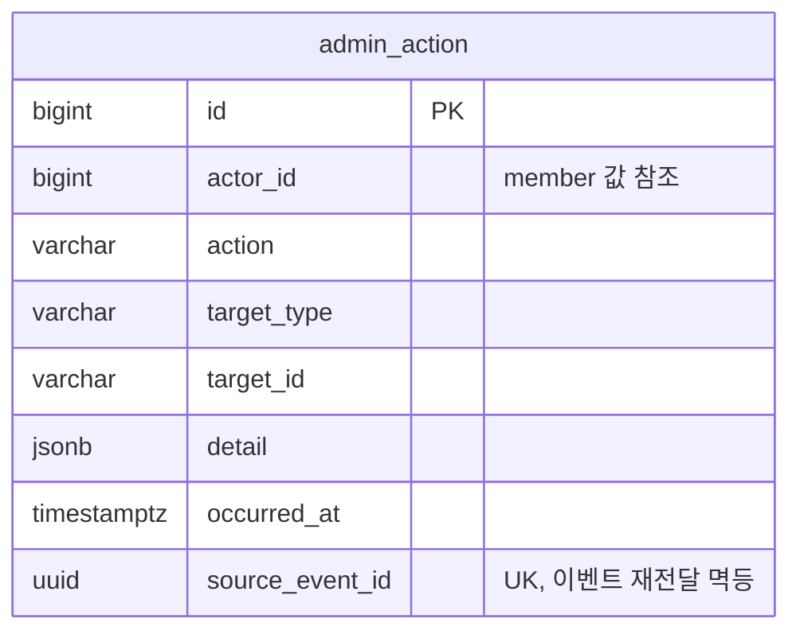

# 데이터 — PostgreSQL과 ERD (§5)

> [← 아키텍처 개요](../architecture.md) · 범위: §5 데이터 중 PostgreSQL 스키마 규칙, ERD, JPA·jOOQ 역할 분담
> 함께 보기: [redis.md](./redis.md)

## PostgreSQL

- 인스턴스 하나, **모듈별 스키마 분리**: `member`, `catalog`, `booking`, `payment`, `settlement`, `coupon`, `audit`, `batch`
- **모듈 간 외래 키·조인 금지**
- `settlement`의 집계에 필요한 타 모듈 데이터는 이벤트로 받아 자기 스키마에 사본으로 쌓는다.
- 스키마 관리는 Flyway, jOOQ 코드는 Flyway가 만든 스키마에서 생성한다.

## booking 스키마 데이터

- **좌석 사본**: `booking`은 `catalog`의 `ScheduleRegistered`를 받아 `booking.schedule`과 `booking.schedule_seat`에 회차와 좌석·가격 사본을 둔다. `catalog`를 직접 조회하지 않는다.
- **`booking.sold_seat (schedule_id, seat_id)`**: 확정 시에만 행을 넣고 취소 시 지우는 테이블이며 여기에 유니크 제약을 둔다. 예매 좌석 테이블에 유니크를 걸면 취소·만료된 예매가 좌석을 계속 점유하기 때문이다.

## 테이블 구조 (ERD)

스키마별로 그린다. 스키마를 넘는 관계는 FK가 없고 값으로만 참조하므로 선을 긋지 않고 주석으로 표시한다. 원본은 `core/src/main/resources/db/migration/V*.sql`이다. 이 외에 `public.event_publication`(Modulith 이벤트 발행 레지스트리)과 `batch` 스키마(Spring Batch 메타데이터, 공식 DDL)가 있다.

### member



### catalog



### booking

`schedule`, `schedule_seat`는 `ScheduleRegistered`로 받은 catalog 사본이다.



### payment

```mermaid
erDiagram
    payment {
        bigint id PK
        bigint order_id UK "booking.booking.id 값 참조"
        bigint member_id "member 값 참조"
        numeric(12,0) amount
        varchar status "REQUESTED, SUCCEEDED, FAILED, REFUND_REQUESTED, REFUNDED"
        varchar idempotency_key UK
        varchar pg_transaction_id UK
        text failure_reason
        timestamptz requested_at
        timestamptz approved_at
        timestamptz failed_at
        timestamptz refund_requested_at
        timestamptz refunded_at
        bigint version
    }
    webhook_event {
        varchar event_id PK "웹훅 중복 제거"
        varchar type
        varchar transaction_id "pg_transaction_id 값 참조"
        timestamptz received_at
    }
    pg_transaction_snapshot {
        date target_date PK
        varchar(100) transaction_id PK
        bigint order_id "booking 값 참조"
        numeric amount
        varchar(32) status
        timestamptz requested_at
        timestamptz approved_at
        timestamptz refunded_at
        timestamptz fetched_at
    }
    reconciliation_mismatch {
        date target_date PK
        bigint order_id PK "booking 값 참조"
        varchar(32) mismatch_type PK
        varchar(100) pg_transaction_id
        varchar(32) pg_status
        numeric pg_amount
        bigint internal_payment_id
        varchar internal_status
        numeric internal_amount
        timestamptz detected_at
    }
```

### settlement

```mermaid
erDiagram
    booking_sale {
        bigint booking_id PK
        bigint performance_id
        bigint organizer_id
        bigint schedule_id
        numeric(12,0) amount "결제 금액"
        numeric(12,0) list_amount "정가"
        numeric(12,0) discount_amount "쿠폰 할인액"
        timestamptz confirmed_at
        timestamptz received_at
    }
    booking_refund {
        bigint booking_id PK
        bigint performance_id
        bigint organizer_id
        varchar reason
        timestamptz cancelled_at
        timestamptz received_at
    }
    daily_settlement {
        date settlement_date PK
        bigint performance_id PK
        bigint organizer_id
        integer sale_count
        numeric sale_amount "정가(list_amount) 합계"
        integer refund_count
        numeric refund_amount "환불 건의 정가 합계"
        numeric net_amount
        numeric(5,4) fee_rate
        numeric fee_amount
        numeric payout_amount
        numeric platform_discount_amount "판매 건 discount_amount 합계, ADR 0036"
        timestamptz calculated_at
    }
```

### coupon

`issued_coupon`의 `(definition_id, member_id)` 유니크 제약이 중복 발급의 최종 방어선이다(ADR 0037). `booking`은 발급 쿠폰 ID와 시도 ID를 값으로 보관한다.



`reservation_attempt`는 마지막 시도를 기억해 과거 요청의 재예약을 방지한다. `use_mismatch`는 해제 후 사용 확정을 복구할 때 이전 상태를 남긴다. [ADR 0045](../adr/0045-coupon-reservation-attempts.md)

### audit



## JPA와 jOOQ 역할 분담

- 명령(쓰기): JPA. JPA로 표현할 수 없는 쓰기(`ON CONFLICT` upsert, 엔티티 없는 테이블)는 jOOQ DSL. 문자열 SQL은 쓰지 않는다
- 조회(목록, 통계, 정산 집계): jOOQ
- 출력 포트를 `CommandPort` / `QueryPort`로 나누고 어댑터를 각각 구현한다.
