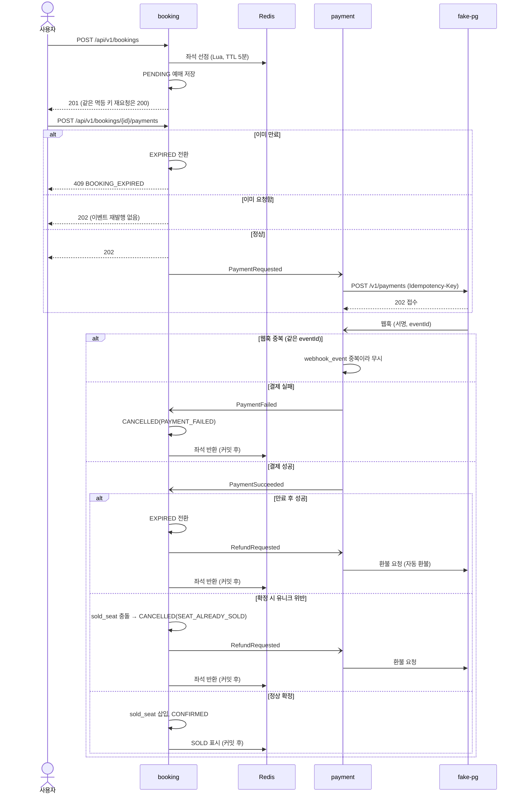

# 6. 핵심 흐름

> [← 아키텍처 개요](../architecture.md) · 범위: §6 핵심 흐름(대기열, 좌석 선점, 예매 시퀀스, 상태 전이, 결제)
> 함께 보기: [redis.md](./redis.md), [erd.md](./erd.md)

## 6.1 대기열과 입장

1. 사용자가 예매 페이지 진입 시 실시간 앱의 대기열(Sorted Set)에 등록된다.
2. 실시간 앱이 순번을 SSE로 push한다.
3. 차례가 되면 **짧은 수명의 입장 토큰**을 발급한다.
4. Gateway가 예매 API 요청에서 입장 토큰을 검증한다. 코어는 관여하지 않는다.

Gateway 규칙 ([ADR 0020](../adr/0020-gateway-verification-contracts.md)):

- `/api/v1/queues/**`와 `/api/v1/streams/**`는 각각 `realtime-queues`, `realtime-streams` 라우트로 realtime에 전달한다. `POST /api/v1/bookings`는 `core-bookings-create`, 그 밖의 `/api/v1/**`는 `core-api` 라우트로 core에 전달한다.
- 입장 토큰은 `POST /api/v1/bookings`에만 적용하고, 검증된 회원과 요청 본문의 회차를 대조한다. 토큰이 없으면 403 `ADMISSION_TOKEN_REQUIRED`, 무효·만료·불일치면 403 `ADMISSION_TOKEN_INVALID`로 응답하며 클라이언트는 두 코드에 대기열로 돌려보낸다.
- 예매 생성 본문의 크기 상한은 `ticketing.gateway.booking-body-max-bytes`로 설정하며 기본값은 16KB다. 상한 초과나 잘못된 본문은 400 `INVALID_REQUEST_BODY`로 응답한다.
- SSE 티켓은 `/api/v1/streams/**`에서 `?ticket=`으로 받아 한 번 소비한다. 검증 실패 시 401 `SSE_TICKET_INVALID`로 응답한다.
- 스트림 CORS는 `/api/v1/streams/**`에만 설정된 web origin(기본 `http://localhost:13000`)과 GET을 허용하며 자격 증명은 허용하지 않는다.
- rate limit은 `core-api`와 `realtime-queues`에 `default`(초당 보충 20, 버스트 40), 예매 생성에 `booking-create`(2, 5), 스트림에 `streams`(5, 10) 설정을 적용한다. 키는 검증된 회원의 `member:<id>` 또는 비회원의 `ip:<주소>`이며, `X-Forwarded-For`는 설정된 신뢰 프록시 홉 수(기본 1)만 사용한다. 초과 시 429 `RATE_LIMITED`와 `X-RateLimit-*` 헤더를 반환한다. Redis 오류 시 Spring Cloud Gateway `RedisRateLimiter`의 기본 동작에 따라 요청을 허용한다.

realtime 규칙 ([ADR 0021](../adr/0021-realtime-queue-and-sse-contracts.md)):

- 대기열 API는 `POST /api/v1/queues/{scheduleId}/entries`(등록), `GET /api/v1/queues/{scheduleId}/entries/me`(상태 조회), `DELETE /api/v1/queues/{scheduleId}/entries/me`(이탈)다. 상태는 `WAITING` 또는 `ADMITTED`다.
- 대기열 응답 필드는 `status`와 상태별 `position`(WAITING), `admissionToken`·`expiresAt`(ADMITTED)다.
- 설정 접두사는 `ticketing.realtime.queue.*`이며 기본값은 `admission-interval=PT1S`, `admission-batch-size=50`, `admission-token-ttl=PT10M`, `presence-grace=PT30S`, `position-poll-interval=PT1S`, `heartbeat-interval=PT15S`다. `admission-enabled`는 기본 활성화다.
- 입장 스케줄러는 기본 1초 주기로 회차별 최대 50명을 입장시키며, 입장 토큰 TTL 기본값은 10분이다.
- SSE heartbeat와 대기 상태 조회는 마지막 신호를 기록한다. 기본 30초 유예를 넘긴 대기자는 입장 직전에 제거한다.
- 순번 SSE 경로는 `GET /api/v1/streams/queues/{scheduleId}`이며 `position`(본문 `position`), `admitted`(본문 `admissionToken`, `expiresAt`), `removed` 이벤트를 보낸다. 좌석 SSE 경로는 `GET /api/v1/streams/schedules/{scheduleId}/seats`이며 `snapshot`(본문 `seats`), `seat`(본문 `seatIds`, `status`, `holdExpiresAt`, `at`) 이벤트를 보낸다. 두 스트림 모두 15초마다 heartbeat 주석을 보낸다.
- 좌석 SSE의 `Last-Event-ID`가 Stream에 남아 있으면 이후 변경을 재생하고, 형식이 잘못됐거나 Stream에서 잘려 나간 ID면 스냅샷부터 보낸다. 헤더가 없으면 `lastEventId` 쿼리를 쓴다(브라우저 재연결용, [ADR 0022](../adr/0022-bff-session-and-aggregation-apis.md)).
- 인증된 회원 ID가 없거나 숫자가 아니면 401 `UNAUTHORIZED`, 코어가 만든 회차 좌석 스냅샷 키가 없으면 404 `SCHEDULE_NOT_FOUND`, 회원의 대기열 항목이 없으면 404 `QUEUE_ENTRY_NOT_FOUND`로 응답한다.
- 좌석 SSE는 인스턴스마다 회차별 공유 리더가 비블로킹 `XREAD`를 주기적으로 실행한다.

코어가 Gateway를 우회해 직접 노출되지 않도록 하는 네트워크 구성은 M6(k8s)에서 적용한다 ([ADR 0008](../adr/0008-queue-in-realtime-app.md)).

## 6.2 좌석 선점

- 1회 예매 최대 **4매**
- 선점 유지 시간(TTL) **5분**
- 여러 좌석은 Lua 스크립트로 **전부 성공하거나 전부 실패**
- 최종 확정은 결제 성공 시 DB 기록. `booking.sold_seat`의 `(회차, 좌석)` **유니크 제약**이 마지막 방어선
- API 흐름: `POST /api/v1/bookings`가 Redis 선점과 `PENDING` 생성을 하고, `POST /api/v1/bookings/{id}/payments`가 결제 요청 이벤트를 발행한다.
- 선점·해제·확정 시 좌석 상태 변경을 Redis Streams로 발행하고 스냅샷을 갱신한다.

## 6.2.1 예매 흐름 시퀀스 (대기열 제외)



- 금액 불일치(`AMOUNT_MISMATCH`)도 환불 경로이며 위 유니크 위반과 같은 모양이다.
- `PaymentRequested`, `PaymentSucceeded` 같은 화살표(`-)`)는 Modulith 이벤트(비동기)다.

## 6.3 예매 상태 전이

```
PENDING ──결제 성공──▶ CONFIRMED ──사용자 취소(환불 요청)──▶ CANCELLED(USER_REQUESTED)
   │
   ├──시간 초과──▶ EXPIRED
   ├──사용자 취소──▶ CANCELLED(USER_REQUESTED)
   ├──결제 실패──▶ CANCELLED(PAYMENT_FAILED)
   ├──결제 금액 불일치──▶ CANCELLED(AMOUNT_MISMATCH) + 환불 요청
   └──확정 시 이미 판매된 좌석──▶ CANCELLED(SEAT_ALREADY_SOLD) + 환불 요청
```

- **만료는 지연 판정**: 예매는 `expiresAt = 생성 시각 + 5분`을 갖는다. 결제 요청이나 결제 결과가 도착했을 때 `Clock`과 비교해 `EXPIRED`로 전환한다. 일괄 정리는 M2 Batch가 한다.
- **결제 실패**: `PENDING → CANCELLED`(사유 `PAYMENT_FAILED`)로 바꾸고 좌석을 반환한다. 재결제는 없다.
- **확정 예매 취소**: 즉시 `CANCELLED`(`USER_REQUESTED`)로 바꾸고 `RefundRequested`를 발행한다. 환불은 비동기다.
- **결제 금액 불일치**: 결제는 성공했지만 금액(`compareTo`)이 `totalPrice`와 다르면 확정하지 않는다. `PENDING → CANCELLED`(`AMOUNT_MISMATCH`)로 바꾸고 `RefundRequested`(사유 `AMOUNT_MISMATCH`)와 `BookingCancelled`(`refundRequired=true`)를 발행하며 커밋 후 선점을 해제한다. `sold_seat`는 넣지 않는다. 만료 판정이 먼저라서 만료됐으면 불일치여도 `EXPIRED` 환불 경로다.
- **결제 재요청**(`POST /api/v1/bookings/{id}/payments`): `PENDING`이면 이미 요청했어도 `202`(이벤트는 다시 발행하지 않는다). 이미 요청했다면 만료 시각이 지나도 결제가 진행 중이므로 `202`다. `CONFIRMED`, `CANCELLED`는 `409 INVALID_BOOKING_STATE`, `EXPIRED`는 `409 BOOKING_EXPIRED`.
- **동시 수정 충돌**: HTTP 요청 경로에서 `Booking`의 낙관적 락(`@Version`) 충돌이 나면 `ApiExceptionHandler`가 `409 CONCURRENT_MODIFICATION`으로 변환하며 클라이언트가 다시 시도한다. 이벤트 리스너 경로는 예외를 그대로 던져 이벤트 발행 레지스트리가 재시도한다.
- 같은 결제 결과 이벤트가 다시 와도 상태는 다시 바뀌지 않는다(멱등).

## 6.4 결제 (이벤트 기반)

1. `booking`이 결제 요청 이벤트 발행
2. `payment`가 가짜 PG에 결제 요청 (멱등 키 포함)
3. 가짜 PG가 웹훅으로 결과 통지 (지연, 실패, 중복 가능)
4. `payment`가 멱등 키로 중복을 걸러내고 결과 이벤트 발행
5. `booking`이 `CONFIRMED` 또는 실패 처리(`CANCELLED`, 사유 `PAYMENT_FAILED`, 좌석 반환)

**자동 환불 조건**: 결제는 성공했는데 (a) 예매가 이미 만료됐거나(`EXPIRED`로 전환), (b) 확정 시 `booking.sold_seat` 유니크 제약에 걸려 좌석이 이미 판매된 경우(`CANCELLED`, 사유 `SEAT_ALREADY_SOLD`), `booking`이 `RefundRequested`를 발행해 자동 환불한다.

**결제 결과 처리의 트랜잭션 구조**
- 결과 이벤트는 `@ApplicationModuleListener`(비동기 + 새 트랜잭션)로 받고, DB 작업은 그 리스너 트랜잭션 하나에 참여한다. 내부에서 `REQUIRES_NEW`를 또 열지 않는다. 리스너가 가상 스레드로 상한 없이 동시에 돌아 커넥션을 두 개씩 잡으면 풀 고갈과 교착이 생기기 때문이다.
- 확정 순서는 확정 가능 여부 판정 → `sold_seat` 삽입(`ON CONFLICT DO NOTHING`) → 전부 들어가면 `CONFIRMED`, 일부라도 충돌하면 같은 트랜잭션에서 이 예매의 `sold_seat`를 지우고 `SEAT_ALREADY_SOLD`로 취소한다. 충돌해도 트랜잭션이 깨지지 않아 롤백 후 재시도가 필요 없다.
- Redis 반영(SOLD 표시, 선점 해제)은 트랜잭션 `afterCommit`에서 한다. 롤백되면 Redis를 건드리지 않는다. 선점 해제는 이미 SOLD인 좌석의 스냅샷을 `AVAILABLE`로 되돌리지 않는다(선점 키가 유실돼 두 예매가 같은 좌석을 선점한 뒤 확정에 진 쪽의 해제가 이긴 쪽의 SOLD를 덮어쓰는 것을 막는다).
- **커밋 후 Redis 반영이 실패하면** 경고 로그만 남긴다. 선점 키는 TTL로 정리되고 스냅샷 보정은 M2 Batch가 한다. 중복 판매는 DB 유니크 제약이 막는다.
- 낙관적 락 충돌은 삼키지 않고 던져 이벤트 발행 레지스트리가 다시 시도하게 한다.

이 구조는 MSA 전환 시 Saga로 그대로 이어진다.

**payment 구현 세부**

- PG를 호출하는 결제·환불 리스너는 `@ApplicationModuleListener(propagation = NOT_SUPPORTED)`로 실행한다. 준비 저장 → 트랜잭션 밖 PG 호출 → 최신 행 재조회·결과 반영으로 나눈다. 위의 booking 결제 결과 리스너 트랜잭션 구조와는 역할이 다르다.
- 결제 상태는 `REQUESTED`, `SUCCEEDED`, `FAILED`, `REFUND_REQUESTED`, `REFUNDED`다. 결제의 미확정 결과(타임아웃·연결 실패·5xx)는 REQUESTED를 유지하고 예외를 전파해 원 이벤트를 미완료로 남긴다. 확정적 거절만 PaymentFailed로 처리한다.
- 환불 거절·미확정은 REFUND_REQUESTED를 유지하고 예외를 전파한다. 해당 상태에서도 동일한 `refund-{orderId}` 키로 PG에 다시 요청한다. REFUNDED면 종료한다.
- 재시작·명시적 이벤트 재제출 시 같은 키와 본문으로 재처리한다. 미완료 기록 자체가 즉시 재시도를 뜻하지 않으며, 주기적 스케줄러는 M1-5에 추가하지 않는다. 웹훅과 M2 대사는 별도 복구 경로다.
- 웹훅 중복 기록·결제 상태 저장·결과 이벤트 발행은 한 트랜잭션이다. 오류 시 중복 기록도 롤백한다. 웹훅 선도착과 지연 PG 응답이 최신 상태를 되돌리지 않게 한다. 병렬 재처리의 HTTP 호출 횟수 대신 실제 거래·환불과 커밋된 상태 전이·이벤트의 중복 방지를 보장한다.
- 설계 근거는 [ADR 0018](../adr/0018-payment-retry-boundaries.md), 별도 세션 지시서(`phases/3-payment`)는 완료 후 삭제되어 git 히스토리에만 남아 있다. `PaymentListenerTests`와 `PaymentFlowTests`에서 트랜잭션 경계, 실제 예매 연계와 원 발행 재제출을 검증한다.
